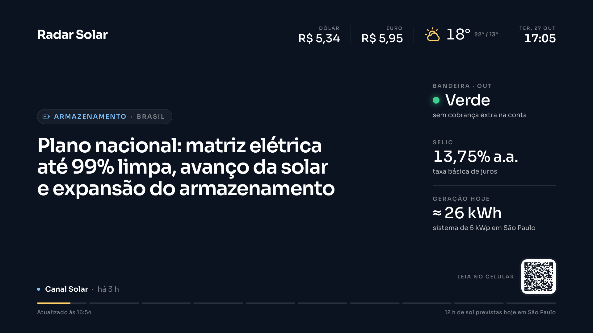

# Radar de Notícias para TV

Uma tela de notícias para a TV do escritório, sobre o tema que você quiser. Gratuita, automática e sem servidor.



- Lê os portais do seu setor a cada 2 horas e escolhe as 10 notícias mais relevantes dos últimos 3 dias.
- Mostra uma notícia por vez, com QR code para ler no celular, além de data, hora e clima da sua cidade.
- Pode mostrar também a cotação do dólar e do euro e um painel lateral com bandeira tarifária, taxa Selic e estimativa de geração solar do dia.
- Funciona no navegador de Smart TVs, inclusive modelos antigos.
- Custo zero: roda no GitHub Actions e é publicado no Cloudflare Pages, ambos no plano gratuito.
- Opcional: com uma chave da Anthropic, o Claude escolhe as notícias, reescreve os resumos e traduz notícias internacionais.

O exemplo que vem configurado é um radar do mercado de energia solar no Brasil. Troque o tema editando um único arquivo: `site/config.json`.

## Como criar o seu

1. **Copie o projeto.** Clique em **Use this template → Create a new repository** no GitHub. O repositório pode ser privado.
2. **Defina o tema** em `site/config.json` (veja abaixo).
3. **Rode o robô pela primeira vez.** Na aba **Actions** do seu repositório, abra **Atualizar notícias** e clique em **Run workflow**. Depois disso ele roda sozinho.
4. **Publique a página.** No [Cloudflare](https://dash.cloudflare.com), vá em **Workers e Pages → Criar → Pages → Conectar ao Git**, escolha o repositório e preencha:
   - Comando de build: *(deixe vazio)*
   - Diretório de saída: `site`
5. **Abra o link na TV**, por exemplo `seu-projeto.pages.dev`, e salve nos favoritos do navegador.

## Configurando o tema (`site/config.json`)

| Campo | O que faz |
|---|---|
| `name` | Nome exibido no topo da tela, quando não há logo. |
| `logo` | Caminho de uma imagem dentro de `site/`, por exemplo `"assets/logo.svg"`. Deixe `""` para mostrar o nome. |
| `colors` | `background` (fundo), `accent` (categoria da notícia) e `highlight` (ícone do clima, barra de progresso e detalhes). |
| `city` | Cidade do clima, com latitude e longitude. |
| `showSunHours` | Mostra no rodapé as horas de sol previstas para o dia. |
| `showCurrency` | Mostra no topo a cotação do dólar e do euro em reais, atualizada a cada 15 minutos. |
| `panel` | Painel na lateral direita. `tariffFlag` mostra a bandeira tarifária do mês (ANEEL), `selic` mostra a taxa Selic (Banco Central) e `solarKwp` mostra quanto um sistema dessa potência deve gerar hoje na sua cidade. Use `false` (ou `0` em `solarKwp`) para esconder um item; sem nenhum, o painel some e a notícia ocupa a tela toda. A bandeira é buscada pelo robô e só aparece depois que ele rodar. |
| `slideSeconds` | Tempo de cada notícia na tela. |
| `topic.audience` | Quem lê a TV. Usado só no modo com IA. |
| `topic.priorities` | Que assuntos priorizar. Usado só no modo com IA. |
| `topic.keywords` | Uma notícia só entra se citar uma destas palavras, ou se vier de um portal especializado. |
| `topic.titleKeywords` | Notícias com estas palavras **no título** sobem na lista. |
| `topic.specialistSources` | Portais dedicados ao tema: tudo deles entra e eles ganham prioridade. Use o nome como aparece nas fontes. |
| `topic.maxInternational` | Máximo de notícias internacionais. Usado só no modo com IA. |
| `categories` | Etiquetas das notícias, com nome, ícone e palavras que as identificam. A última é usada quando nenhuma outra combina. |
| `feeds` | Portais lidos. Use `url` para o feed RSS do site, ou `googleNews` com uma busca do Google Notícias para sites sem RSS. `region` é `BR` ou `INT`. |

**Palavras-chave:** um `*` no final aceita qualquer terminação. Por exemplo, `regula*` encontra regulação, regulamento e regulatório.

**Ícones disponíveis para as categorias:** `documento`, `grafico`, `lampada`, `moeda`, `bateria`, `raio`, `folha`, `globo`, `predio`, `pessoas`, `carro` e `noticia`.

**Encontrando o feed de um portal:** muitos sites têm o feed em `/feed/` ou `/rss`. Se não houver, use `googleNews` com `"site:portal.com.br"`. Para juntar vários sites numa só fonte, use `"site:a.com.br OR site:b.com.br"`.

## Como as notícias são escolhidas (modo gratuito)

1. Coleta as notícias das últimas 72 horas de todas as fontes e remove as repetidas.
2. Mantém só as brasileiras, que vêm de um portal especializado ou citam uma palavra-chave do tema.
3. Descarta vagas de emprego e títulos genéricos.
4. Pontua cada notícia: +2 se o título tem uma palavra de `titleKeywords` e +1 se vem de um portal especializado.
5. Mostra as 10 com maior pontuação, com no máximo 3 por portal. No empate, entra a mais recente.

Se uma rodada encontrar menos de 3 notícias, a tela mantém as anteriores.

## Modo com IA (opcional, pago)

Adicione o segredo `ANTHROPIC_API_KEY` em **Settings → Secrets and variables → Actions**. A partir daí, o Claude escolhe as notícias e escreve títulos e resumos curtos em português. Ele também inclui notícias internacionais relevantes, já traduzidas.

O modelo fica no topo de `scripts/update-news.mjs`. Para reduzir o custo, use `claude-haiku-5-5`.

## Rodar no computador

```bash
npm install
npm run dry-run                  # só lista as notícias coletadas
npm run update                   # grava site/news.json
python3 -m http.server 8080 --directory site
```

Depois abra `http://localhost:8080`.

## De onde vêm os dados

Todas as fontes são gratuitas e não pedem cadastro.

| Dado | Fonte |
|---|---|
| Notícias | Feeds RSS e Google Notícias, definidos em `feeds` |
| Clima, horas de sol e irradiação | [Open-Meteo](https://open-meteo.com) |
| Dólar e euro | [AwesomeAPI](https://docs.awesomeapi.com.br) |
| Selic | [API do Banco Central](https://dadosabertos.bcb.gov.br) (série 432) |
| Bandeira tarifária | [Dados abertos da ANEEL](https://dadosabertos.aneel.gov.br) |

## Ajustes avançados

- **Horários do robô:** linha `cron` em `.github/workflows/update-news.yml`. O padrão é a cada 2 horas, das 7h às 19h de Brasília, de segunda a sexta.
- **Quantidade de notícias e janela de tempo:** constantes no topo de `scripts/update-news.mjs`.
- **Tamanhos e layout:** `site/styles.css`. A tela é desenhada em 1920×1080 e se ajusta a qualquer TV.

## Estrutura do projeto

```
site/                     a página publicada na TV
  index.html              estrutura da tela
  styles.css              visual (palco fixo de 1920×1080)
  app.js                  carrossel, relógio, clima, câmbio e painel
  config.json             tema, cores, cidade e fontes de notícias
  news.json               notícias escolhidas (gravado pelo robô)
scripts/update-news.mjs   robô que coleta e escolhe as notícias
.github/workflows/        agenda do robô no GitHub Actions
```

O `app.js` é escrito em JavaScript simples, sem recursos modernos, para funcionar nos navegadores de Smart TVs antigas. Mantenha esse estilo ao fazer mudanças.

## Licença

MIT. Use, adapte e compartilhe à vontade.
